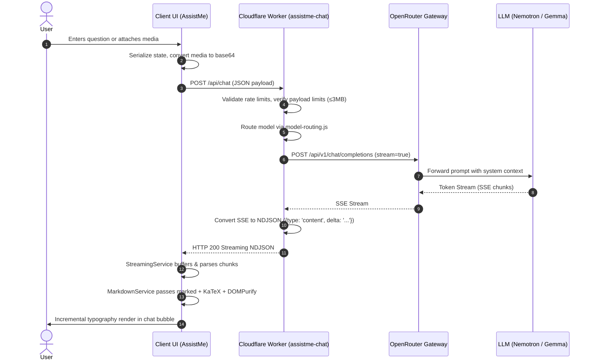
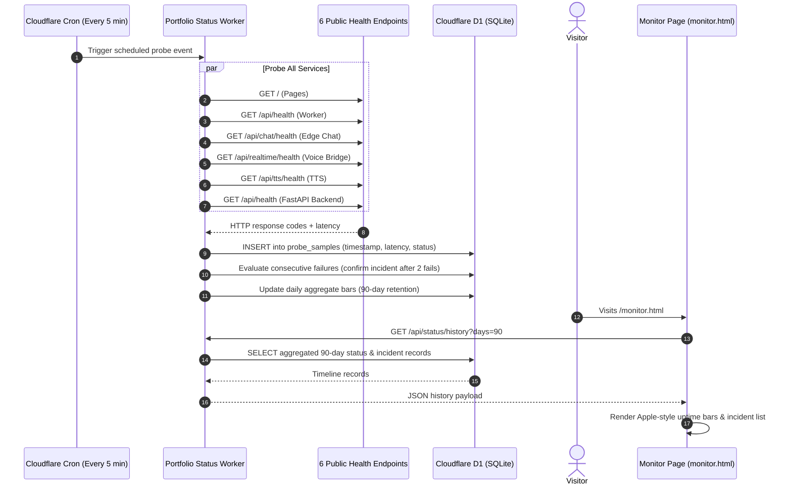
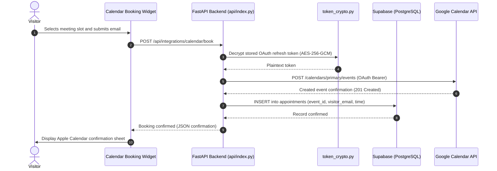
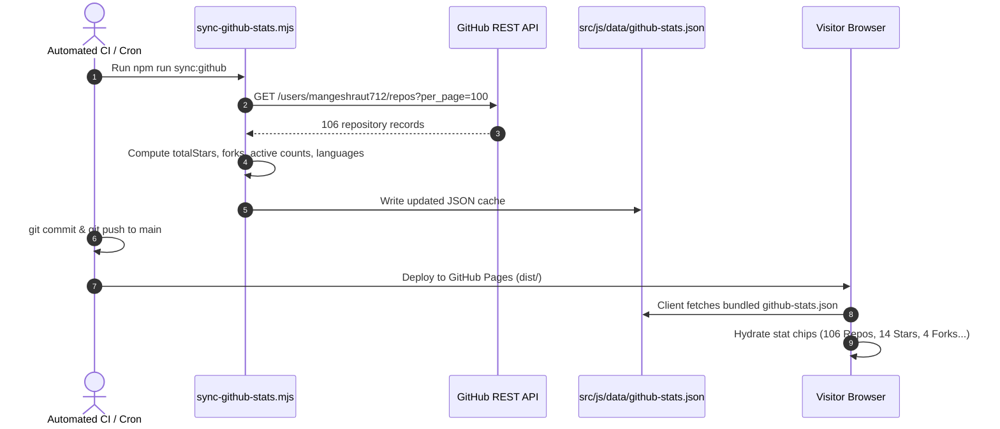

# System Architecture & Technical Specifications

> **Repository**: `mangeshrautarchive`  
> **Runtime Strategy**: Vanilla Native Web + Edge Microservices + Serverless Python  
> **Hosting & Edge**: GitHub Pages (Static Delivery) + Cloudflare Workers (Primary Edge API) + Cloudflare D1 (Uptime SQLite DB) + Vercel / Local FastAPI (Backend Services)  
> **Design Standard**: Apple Human Interface Guidelines (SF Pro, `--apple-*` design tokens, frosted glassmorphism, specular sheen)

---

## 1. High-Level Architecture

The architecture separates static content delivery from dynamic edge compute and persistent backend integrations:

```mermaid
flowchart TD
    Client["Client Browser<br/>(HTML5 / Vanilla CSS / Native ES Modules)"]

    subgraph StaticHost ["Static Delivery (GitHub Pages CDN)"]
        Pages["Static Publish (dist/)<br/>index, systems, monitor, travel, uses, changelog"]
    end

    subgraph EdgeLayer ["Edge Microservices (Cloudflare Workers)"]
        ChatWorker["Chat & Inference Worker<br/>workers/assistme-chat/<br/>(Streaming / Model Routing / Live Search)"]
        StatusWorker["Portfolio Status Worker<br/>workers/portfolio-status/<br/>(5-min Cron Collector / Status API)"]
        D1Database[("Cloudflare D1 Database<br/>(Uptime & Incident History SQLite)")]
    end

    subgraph BackendLayer ["Backend Services (FastAPI / Python 3.12+)"]
        FastAPIApp["FastAPI Service (api/index.py)<br/>(OAuth, Cryptography, Probes, Ingest)"]
        SupabaseDB[("Supabase PostgreSQL<br/>(Bookings, Integrations State)")]
    end

    subgraph ExternalServices ["External Providers & AI APIs"]
        OpenRouter["OpenRouter AI Gateway<br/>(Nemotron / Gemma / Omni)"]
        GitHubAPI["GitHub REST & GraphQL API"]
        CalendarProviders["Calendar APIs<br/>(Google, Apple, Microsoft)"]
        HealthAPIs["Biometric Telemetry<br/>(Whoop, Withings)"]
    end

    Client -->|1. Static HTTP GET| Pages
    Client -->|2. POST /api/chat (NDJSON stream)| ChatWorker
    Client -->|3. GET /api/status/history| StatusWorker
    Client -.->|4. Local Dev / Serverless API| FastAPIApp

    ChatWorker -->|Inference Proxy & Fallback| OpenRouter
    ChatWorker -->|Cached Public Proxy| GitHubAPI
    StatusWorker -->|Scheduled Cron Probes| Pages
    StatusWorker -->|Scheduled Cron Probes| ChatWorker
    StatusWorker -->|Persist Observation Samples| D1Database

    FastAPIApp -->|Calendar OAuth & Sync| CalendarProviders
    FastAPIApp -->|Persist Bookings & Sessions| SupabaseDB
    FastAPIApp -->|Fetch Vitals & Activity| HealthAPIs
    FastAPIApp -->|Direct Fallback Chat| OpenRouter
```

---

## 2. Directory Layout & Folder Structure

```text
mangeshrautarchive/
├── src/                               # Frontend source assets (compiled to dist/)
│   ├── index.html                     # Primary portfolio homepage shell
│   ├── systems.html                   # Architecture & system engineering case studies
│   ├── monitor.html                   # Operational health, latency probes, system telemetry
│   ├── travel.html                    # Interactive travel atlas & route maps
│   ├── uses.html                      # Hardware, software, AI stack, and workspace gear
│   ├── changelog.html                 # Version history, multi-model attribution, commit logs
│   ├── 404.html · offline.html        # Resilient error handling and offline PWA fallbacks
│   ├── manifest.json                  # Web App Manifest for PWA installation
│   ├── service-worker.js              # Service worker handling runtime asset caching
│   ├── js/                            # Modular JavaScript (100% vanilla ES modules)
│   │   ├── entry.js                   # Application bootstrap entry point
│   │   ├── core/                      # Global UI chrome, theme bootstrapper, navigation
│   │   ├── chatbot/                   # AssistMe agentic core, session memory, streaming engine
│   │   ├── modules/                   # Surface-specific controllers (projects, monitor, travel)
│   │   ├── services/                  # Network, analytics, streaming, and markdown services
│   │   ├── utils/                     # Reusable utilities (theme, performance, math, DOM)
│   │   ├── data/                      # Static catalogues, changelog entries, project metadata
│   │   └── vendor/                    # Self-hosted KaTeX, Marked, and DOMPurify bundles
│   └── assets/
│       ├── css/                       # Component-level vanilla stylesheets
│       ├── images/                    # Verified screenshots, brand assets, icons
│       └── files/                     # Downloadable assets (PDF resumes, transcripts)
├── api/                               # FastAPI backend application (Python 3.12+)
│   ├── index.py                       # ASGI entry point & route registration
│   ├── config.py                      # Pydantic v2 environment configuration & model settings
│   ├── model_router.py                # Server-side LLM model resolution & fallback hierarchy
│   ├── platform_health.py             # Asynchronous concurrency-driven system health checks
│   ├── monitoring.py                  # Live metrics, probe histories, and telemetry aggregation
│   ├── rate_limit.py                  # IP-based sliding-window rate limiting middleware
│   ├── security_headers.py            # Strict CSP, HSTS, and frame protection headers
│   ├── routes/                        # Modular HTTP endpoint routers
│   └── integrations/                  # OAuth connectors, AES-GCM crypto, calendar synchronizers
├── workers/                           # Cloudflare Edge Microservices
│   ├── assistme-chat/                 # Live production edge inference and proxy service
│   │   ├── src/index.js               # Edge router, CORS, streaming chat handler
│   │   ├── src/model-routing.js       # Multi-provider LLM failover and capability routing
│   │   ├── src/live-search.js         # Real-time web search and citation grounding
│   │   └── wrangler.toml              # Cloudflare Worker configuration & bindings
│   └── portfolio-status/              # Durable uptime and incident tracking service
│       ├── src/index.js               # 5-minute scheduled cron probe and REST API
│       ├── wrangler.json              # D1 database bindings and cron trigger setup
│       └── migrations/                # D1 SQLite schema (probes, incidents, aggregates)
├── scripts/                           # Developer, build, and deployment automation tooling
│   ├── build/                         # esbuild bundlers, HTML minifiers, sitemap generators
│   ├── deployment/                    # Lighthouse CI gates, security scanning, deploy sync
│   ├── integrations/                  # Third-party data sync scripts (GitHub, Calendars, Whoop)
│   ├── qa/                            # Browser viewports, responsive, and performance audits
│   └── utils/                         # Dev servers, Python test harnesses, repo doctor
├── tests/                             # Comprehensive automated test suites
│   ├── api/                           # pytest test cases for FastAPI backend endpoints
│   ├── worker/                        # Node test runner tests for edge routing & failover
│   ├── unit/                          # Node test runner tests for markdown, URLs, and logic
│   ├── e2e/                           # Playwright end-to-end user journeys (Desktop/Mobile)
│   └── tester-army/                   # Deterministic browser verification journeys
├── docs/                              # Architecture blueprints, design specs, QA logs
├── dist/                              # Production build output (git-ignored, pushed to Pages)
├── package.json                       # Node dependencies, quality gates, and scripts
├── pyproject.toml                     # Python dependencies (FastAPI, Pydantic, pytest)
├── AGENTS.md                          # Canonical multi-agent briefing and engineering guidelines
└── ARCHITECTURE.md                    # This document
```

---

## 3. What Each Main File Does

### 3.1 Frontend Shell & Core Entry (`src/`)

| File Path                                                                                                                                                                                                 | Role & Responsibilities                                                                                                                                                                                                                  |
| :-------------------------------------------------------------------------------------------------------------------------------------------------------------------------------------------------------- | :--------------------------------------------------------------------------------------------------------------------------------------------------------------------------------------------------------------------------------------- |
| [`src/index.html`](file:///Users/mangeshraut/Desktop/Mangesh/Drexel%20University%20MSCS/Academics/Projects/mangeshrautarchive/src/index.html)                                                             | **Primary Portfolio Shell**: Hosts the semantic structure for the Hero, About, Skills, Experience, Projects (GitHub Operating View + Showcase), Education, Publications, Awards, Blog Preview, Contact, and AssistMe AI assistant modal. |
| [`src/js/entry.js`](file:///Users/mangeshraut/Desktop/Mangesh/Drexel%20University%20MSCS/Academics/Projects/mangeshrautarchive/src/js/entry.js)                                                           | **Client Bootstrap Coordinator**: Entry point loaded via `<script type="module">`. Sequentially boots theme detection, dynamic island navbar, lazy-loaded section observers, scroll animations, and sub-controllers.                     |
| [`src/js/core/chat.js`](file:///Users/mangeshraut/Desktop/Mangesh/Drexel%20University%20MSCS/Academics/Projects/mangeshrautarchive/src/js/core/chat.js)                                                   | **Chatbot UI Coordinator**: Manages the AssistMe window lifecycle, FAB button triggers, active viewing section detection, quick suggestion chips, message list rendering, and sound effects.                                             |
| [`src/js/chatbot/stream.js`](file:///Users/mangeshraut/Desktop/Mangesh/Drexel%20University%20MSCS/Academics/Projects/mangeshrautarchive/src/js/chatbot/stream.js)                                         | **Streaming State Machine**: Reads incoming NDJSON chunks from `/api/chat`, resolves model reasoning blocks, triggers Markdown/KaTeX live rendering passes, and handles mid-stream error recovery.                                       |
| [`src/js/chatbot/agentic-intent.js`](file:///Users/mangeshraut/Desktop/Mangesh/Drexel%20University%20MSCS/Academics/Projects/mangeshrautarchive/src/js/chatbot/agentic-intent.js)                         | **WebMCP Agentic Engine**: Analyzes user input and assistant tool calls to trigger client actions (smooth scrolling to sections, opening project modals, filtering repository categories).                                               |
| [`src/js/modules/github-projects.js`](file:///Users/mangeshraut/Desktop/Mangesh/Drexel%20University%20MSCS/Academics/Projects/mangeshrautarchive/src/js/modules/github-projects.js)                       | **Repository Showcase Controller**: Loads live repository records, maps GitHub language colors, renders interactive cards, manages topic badges, and binds modal preview handlers.                                                       |
| [`src/js/modules/github-contributions-graph.js`](file:///Users/mangeshraut/Desktop/Mangesh/Drexel%20University%20MSCS/Academics/Projects/mangeshrautarchive/src/js/modules/github-contributions-graph.js) | **Contribution Visualizer**: Renders the 3D isometric contribution plate (Three.js/Canvas) and the 2D SVG calendar heatmap, calculating year-over-year statistics and active contribution streaks.                                       |
| [`src/js/modules/monitor-status.js`](file:///Users/mangeshraut/Desktop/Mangesh/Drexel%20University%20MSCS/Academics/Projects/mangeshrautarchive/src/js/modules/monitor-status.js)                         | **Monitor Telemetry Renderer**: Queries the Cloudflare D1 status worker API, rendering 90-day availability bar graphs, live latency gauges, and confirmed incident timelines.                                                            |
| [`src/js/services/StreamingService.js`](file:///Users/mangeshraut/Desktop/Mangesh/Drexel%20University%20MSCS/Academics/Projects/mangeshrautarchive/src/js/services/StreamingService.js)                   | **Streaming HTTP Client**: Wraps native `fetch` with `ReadableStreamDefaultReader` to handle newline-delimited JSON chunks, backoff retries, and network disconnection events.                                                           |
| [`src/js/services/MarkdownService.js`](file:///Users/mangeshraut/Desktop/Mangesh/Drexel%20University%20MSCS/Academics/Projects/mangeshrautarchive/src/js/services/MarkdownService.js)                     | **Sanitized Rendering Pipeline**: Bundles `marked` for markdown parsing, `DOMPurify` for XSS protection, and `KaTeX` for mathematical expressions into an authenticated safe HTML string.                                                |

---

### 3.2 Edge Microservices (`workers/`)

| File Path                                                                                                                                                                                             | Role & Responsibilities                                                                                                                                                                        |
| :---------------------------------------------------------------------------------------------------------------------------------------------------------------------------------------------------- | :--------------------------------------------------------------------------------------------------------------------------------------------------------------------------------------------- |
| [`workers/assistme-chat/src/index.js`](file:///Users/mangeshraut/Desktop/Mangesh/Drexel%20University%20MSCS/Academics/Projects/mangeshrautarchive/workers/assistme-chat/src/index.js)                 | **Edge API Gateway**: Primary Cloudflare Worker handling `/api/chat`, CORS verification, rate-limiting, GitHub REST API proxying, and streaming LLM responses over NDJSON.                     |
| [`workers/assistme-chat/src/model-routing.js`](file:///Users/mangeshraut/Desktop/Mangesh/Drexel%20University%20MSCS/Academics/Projects/mangeshrautarchive/workers/assistme-chat/src/model-routing.js) | **Edge LLM Router**: Selects inference models based on payload type (text, vision, audio, documents) and manages the resilient fallback chain (Nemotron Ultra -> Nemotron Super -> Gemma 27B). |
| [`workers/assistme-chat/src/live-search.js`](file:///Users/mangeshraut/Desktop/Mangesh/Drexel%20University%20MSCS/Academics/Projects/mangeshrautarchive/workers/assistme-chat/src/live-search.js)     | **Real-Time Web Grounding**: Detects queries requiring contemporary context (news, live GitHub stats) and augments prompt context before reaching the inference model.                         |
| [`workers/portfolio-status/src/index.js`](file:///Users/mangeshraut/Desktop/Mangesh/Drexel%20University%20MSCS/Academics/Projects/mangeshrautarchive/workers/portfolio-status/src/index.js)           | **Durable Uptime Engine**: Runs on a 5-minute Cloudflare Cron trigger, pinging 6 public endpoints, recording latency and status in Cloudflare D1, and exposing a public read-only history API. |

---

### 3.3 Python FastAPI Backend (`api/`)

| File Path                                                                                                                                                                             | Role & Responsibilities                                                                                                                                                          |
| :------------------------------------------------------------------------------------------------------------------------------------------------------------------------------------ | :------------------------------------------------------------------------------------------------------------------------------------------------------------------------------- |
| [`api/index.py`](file:///Users/mangeshraut/Desktop/Mangesh/Drexel%20University%20MSCS/Academics/Projects/mangeshrautarchive/api/index.py)                                             | **FastAPI ASGI Application**: Mounts middleware (security headers, CORS, rate limiting), registers route blueprints, handles lifespan startup events, and exposes health probes. |
| [`api/config.py`](file:///Users/mangeshraut/Desktop/Mangesh/Drexel%20University%20MSCS/Academics/Projects/mangeshrautarchive/api/config.py)                                           | **Environment & Model Registry**: Defines Pydantic settings, validated environment variables, model fallback hierarchies, and system configuration constraints.                  |
| [`api/model_router.py`](file:///Users/mangeshraut/Desktop/Mangesh/Drexel%20University%20MSCS/Academics/Projects/mangeshrautarchive/api/model_router.py)                               | **Backend Inference Director**: Resolves incoming model aliases to OpenRouter endpoints with automatic recovery logic and temperature/token budget configurations.               |
| [`api/platform_health.py`](file:///Users/mangeshraut/Desktop/Mangesh/Drexel%20University%20MSCS/Academics/Projects/mangeshrautarchive/api/platform_health.py)                         | **Concurrent Diagnostic Engine**: Asynchronously probes databases, LLM endpoints, external APIs, and local memory metrics to produce unified health status reports.              |
| [`api/integrations/token_crypto.py`](file:///Users/mangeshraut/Desktop/Mangesh/Drexel%20University%20MSCS/Academics/Projects/mangeshrautarchive/api/integrations/token_crypto.py)     | **Token Cryptography**: Implements AES-256-GCM authenticated encryption/decryption for OAuth tokens stored at rest.                                                              |
| [`api/integrations/supabase_store.py`](file:///Users/mangeshraut/Desktop/Mangesh/Drexel%20University%20MSCS/Academics/Projects/mangeshrautarchive/api/integrations/supabase_store.py) | **PostgreSQL Client**: Manages calendar bookings, user authentication state, and integration records in Supabase.                                                                |

---

### 3.4 Build & Tooling Automation (`scripts/`)

| File Path                                                                                                                                                                                             | Role & Responsibilities                                                                                                                                                                  |
| :---------------------------------------------------------------------------------------------------------------------------------------------------------------------------------------------------- | :--------------------------------------------------------------------------------------------------------------------------------------------------------------------------------------- |
| [`scripts/build/build.js`](file:///Users/mangeshraut/Desktop/Mangesh/Drexel%20University%20MSCS/Academics/Projects/mangeshrautarchive/scripts/build/build.js)                                         | **Production Build Orchestrator**: Executes `esbuild`, minifies HTML shells, inlines hero-critical CSS, injects cache-busting version queries, and generates XML sitemaps and RSS feeds. |
| [`scripts/deployment/lighthouse-gate.js`](file:///Users/mangeshraut/Desktop/Mangesh/Drexel%20University%20MSCS/Academics/Projects/mangeshrautarchive/scripts/deployment/lighthouse-gate.js)           | **Lighthouse Quality Gate**: Runs headless Chrome audits enforcing strict 100/100/100/100 score thresholds across Performance, Accessibility, Best Practices, and SEO.                   |
| [`scripts/deployment/security-check.js`](file:///Users/mangeshraut/Desktop/Mangesh/Drexel%20University%20MSCS/Academics/Projects/mangeshrautarchive/scripts/deployment/security-check.js)             | **Secret Leak Scanner**: Scans repository files for accidentally exposed API keys, private tokens, or credentials before commits and deployments.                                        |
| [`scripts/integrations/sync-github-stats.mjs`](file:///Users/mangeshraut/Desktop/Mangesh/Drexel%20University%20MSCS/Academics/Projects/mangeshrautarchive/scripts/integrations/sync-github-stats.mjs) | **GitHub Catalog Synchronizer**: Fetches public repository counts, star counts, forks, and commit activity from GitHub and writes the updated cache to `src/js/data/github-stats.json`.  |

---

## 4. End-to-End Data Flow: UI to Database & Services

### 4.1 Interactive Chat & Streaming Inference Flow



---

### 4.2 Durable Uptime & Incident Telemetry Flow



---

### 4.3 Calendar Booking & OAuth Integration Flow



---

### 4.4 GitHub Portfolio & Metadata Synchronization Flow



---

## 5. The 5 Riskiest Files to Touch

The following files represent the highest architectural risk in the repository due to their coupling, blast radius, and critical role in production availability:

```text
┌─────────────────────────────────────────────────────────────────────────────┐
│                       TOP 5 HIGHEST-RISK FILES                              │
├─────────────────────────────────────────────────────────────────────────────┤
│ 1. workers/assistme-chat/src/index.js      [Live Edge Chat & API Gateway]   │
│ 2. scripts/build/build.js                 [Production Build & Bundler]      │
│ 3. src/js/chatbot/stream.js               [Client NDJSON Streaming Machine] │
│ 4. api/index.py                           [FastAPI ASGI Entry & Middleware] │
│ 5. src/assets/css/projects-showcase-2026.css [Main Layout & CSS Grid Engine]│
└─────────────────────────────────────────────────────────────────────────────┘
```

---

### 1. `workers/assistme-chat/src/index.js` (and `model-routing.js`)

- **Architectural Role**: The production edge entrypoint deployed on Cloudflare Workers. It handles all live chat queries, attachment parsing, rate-limiting, CORS, and inference routing to OpenRouter.
- **Blast Radius**: **Global Production AI Outage**. If an error occurs here, AssistMe completely stops responding for every visitor on `mangeshraut712.github.io`.
- **Failure Modes**:
  - Unhandled promise rejections inside the stream pipeline cause dropped SSE connections.
  - Broken CORS origins lock out valid client requests from GitHub Pages.
  - Faulty stream boundary handling causes model fallback responses to concatenate into corrupted gibberish.
- **Pre-Modification Precautions & Verification**:
  - Run `npm run test:worker` (`tests/worker/chat-routing.test.js`, `endpoints.test.js`).
  - Verify payload limits against the contract: 1.2 MB for images, 3 MB for audio/video/PDF, 75 KB for text.

---

### 2. `scripts/build/build.js`

- **Architectural Role**: The build orchestrator that compiles raw `src/` assets into `dist/`. Inlines critical CSS, minifies HTML shells, stamps deterministic cache-busting tokens, and generates sitemaps and case study pages.
- **Blast Radius**: **Deployment Failure or Site-Wide Rendering Breakage**.
- **Failure Modes**:
  - Incorrect regular expressions during HTML minification can strip required script tags or corrupt inline JSON.
  - Regressions in asset cache-busting (`?v=ASSET_VER`) prevent visitors and CDNs from receiving updated JavaScript and CSS.
  - Any bundle bloat triggers a failure in the Lighthouse 100/100/100/100 deploy gate, blocking GitHub Pages releases.
- **Pre-Modification Precautions & Verification**:
  - Execute `npm run build` and `npm run doctor:stack`.
  - Verify the output directory with `npm run qa:prod-ready` before pushing commits.

---

### 3. `src/js/chatbot/stream.js` (and `src/js/core/chat.js`)

- **Architectural Role**: The client-side streaming engine that decodes raw NDJSON binary buffers from the edge, parses reasoning tokens, applies KaTeX math rendering, and injects sanitized HTML into the DOM.
- **Blast Radius**: **Broken Assistant Interaction & Client-Side Browser Freezes**.
- **Failure Modes**:
  - Memory leaks or infinite re-renders during high-frequency token chunk emission.
  - Uncaught parsing errors when handling partial multi-byte UTF-8 sequences.
  - XSS vulnerabilities if malicious markdown bypasses the `DOMPurify` sanitizer pipeline.
- **Pre-Modification Precautions & Verification**:
  - Run `npx playwright test tests/e2e/chatbot-rich-markdown.spec.js tests/e2e/chatbot-connectivity.spec.js`.
  - Test voice mode and multimodal media attachment flows.

---

### 4. `api/index.py` (and `api/config.py`)

- **Architectural Role**: The core ASGI backend application handling multi-calendar OAuth, token encryption, Supabase persistence, telemetry sync, and diagnostic health probes.
- **Blast Radius**: **Backend Service Failure & OAuth Authentication Lockout**.
- **Failure Modes**:
  - Configuration drift in Pydantic settings crashes the application at startup (`lifespan`).
  - Missing security headers or broken CORS blocks external calendar callbacks.
  - Database connection pool exhaustion under concurrent probe traffic.
- **Pre-Modification Precautions & Verification**:
  - Execute all 215 pytest API tests: `npm run test:api` (or `node scripts/utils/run-pytest.js`).
  - Run static linting with `npm run lint:python` (flake8).

---

### 5. `src/assets/css/projects-showcase-2026.css`

- **Architectural Role**: The primary stylesheet defining responsive grid layouts, 3D card tilt transformations, Apple glassmorphism tokens, and mobile viewports for the portfolio's central showcase.
- **Blast Radius**: **Visual Layout Collapse & CI Quality Gate Failure**.
- **Failure Modes**:
  - Duplicate selectors or syntax issues fail the strict `stylelint "src/assets/css/**/*.css"` check in pre-commit and CI.
  - Unscoped overflow rules cause horizontal page jitter on mobile viewports (breaking the Astra Principle).
  - High-specificity overrides breaking dark mode tokens or contrast compliance (`accessibility.css`).
- **Pre-Modification Precautions & Verification**:
  - Run `npm run lint:css` and `npm run check`.
  - Continuously inspect in-situ rendering across Desktop (1440px) and Mobile (375px) in both light and dark themes.

---

## 6. Testing Strategy & Quality Verification

All changes must pass five independent test suites before merging to `main`:

| Test Suite       | Framework / Runner | Verification Target                                                                         |
| :--------------- | :----------------- | :------------------------------------------------------------------------------------------ |
| **API Suite**    | `pytest`           | 215 tests covering FastAPI endpoints, OAuth token encryption, and probes.                   |
| **Worker Suite** | `node:test`        | 35 tests verifying Cloudflare Worker routing, stream failovers, and D1 persistence.         |
| **Unit Suite**   | `node:test`        | 37 tests validating safe HTML escaping, KaTeX fonts, and sitemap integrity.                 |
| **Critical E2E** | `Playwright`       | 20 user journeys on Desktop Chrome covering forms, chat, and navigation.                    |
| **Tester Army**  | `Playwright`       | 23 deterministic journeys across Chromium and WebKit.                                       |
| **Deploy Gate**  | `Lighthouse CI`    | Enforces 100/100/100/100 thresholds on Performance, Accessibility, Best Practices, and SEO. |
