<div align="center">

# Mangesh Raut · Portfolio

**Software engineering. Considered design. Work you can inspect.**

My portfolio brings together the systems I build, the decisions behind them, and the technology I write about. Built with native web standards, an Apple-inspired interface, and AssistMe, an assistant that can help you explore the work.

[Explore the portfolio](https://mangeshraut712.github.io/mangeshrautarchive/) · [Projects](https://mangeshraut712.github.io/mangeshrautarchive/#projects) · [Journal](https://mangeshraut712.github.io/mangeshrautarchive/blog/) · [Documentation](docs/README.md)

[](https://github.com/mangeshraut712/mangeshrautarchive/actions/workflows/deploy.yml)
[](package.json)
[](pyproject.toml)
[](LICENSE)

</div>

|                                   Light                                    |                                   Dark                                   |
| :------------------------------------------------------------------------: | :----------------------------------------------------------------------: |
| 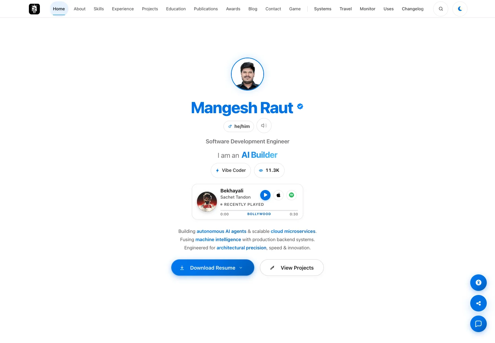 | 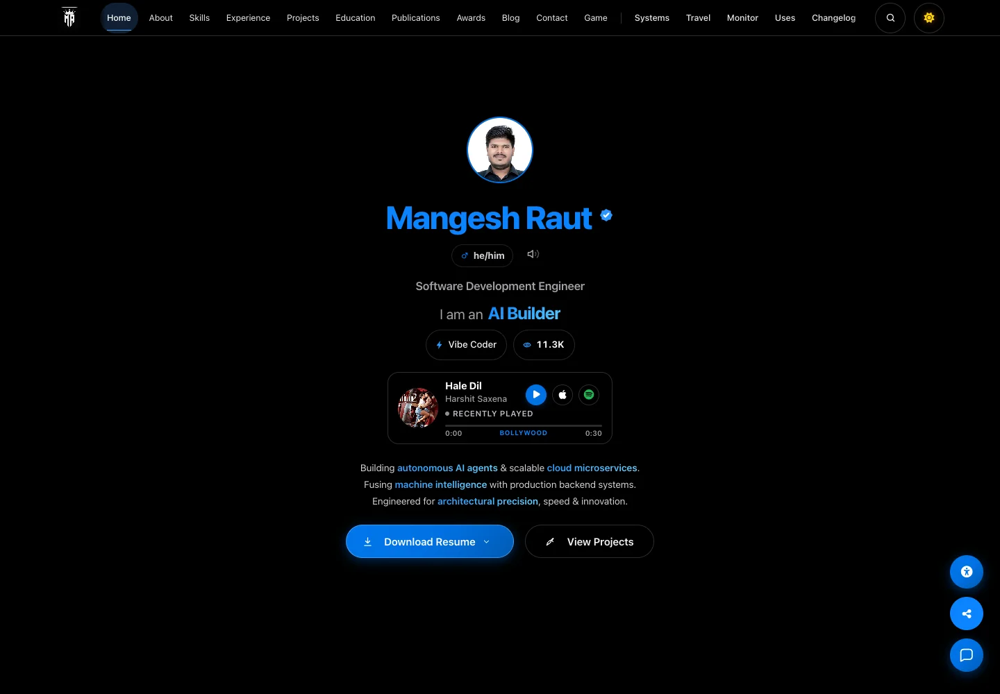 |

Real screenshots of the live website, captured November 9, 2026. [View the gallery and capture details](docs/screenshots/README.md). Live music, counters, and service status can change.

[Experience](#1-the-experience) · [Architecture](#2-how-it-works) · [Run locally](#3-run-locally) · [Verification](#4-engineering-and-verification) · [Contributing](#5-maintenance-and-contribution)

## 1. The experience

- **Portfolio and projects.** My background, experience, education, publications, résumé, and repository case studies, with filters and project previews.
- **A journal with evidence.** Twenty technology articles across January–October 2026: primary sources, worked examples, comparison tables, credited publisher images, and reading resources. Publication dates and editorial review dates remain distinct.
- **AssistMe.** Streaming answers, Markdown, code and mathematics, supported attachments, and browser actions that help visitors find relevant work. Provider availability and voice support depend on configuration and device capabilities.
- **Systems you can inspect.** Architecture notes, a service monitor, engineering workflows, and a changelog that records what changed and who helped build it.
- **A personal side.** A travel atlas, the tools I use, recently played music, world clocks, and contact and calendar features.

| Explore                                                                         | What is inside                                          |
| ------------------------------------------------------------------------------- | ------------------------------------------------------- |
| [Projects](https://mangeshraut712.github.io/mangeshrautarchive/#projects)       | Repository facts, README imagery, filters, and previews |
| [Journal](https://mangeshraut712.github.io/mangeshrautarchive/blog/)            | Research, practical examples, source links, and RSS     |
| [Systems](https://mangeshraut712.github.io/mangeshrautarchive/systems.html)     | Architecture and engineering decisions                  |
| [Monitor](https://mangeshraut712.github.io/mangeshrautarchive/monitor.html)     | Service probes and operational diagnostics              |
| [Travel](https://mangeshraut712.github.io/mangeshrautarchive/travel.html)       | Places, routes, and an on-demand globe                  |
| [Uses](https://mangeshraut712.github.io/mangeshrautarchive/uses.html)           | Hardware, tools, and the development workflow           |
| [Changelog](https://mangeshraut712.github.io/mangeshrautarchive/changelog.html) | Releases, fixes, attribution, and verified commit links |

<details>
<summary><strong>See more of the website in both themes</strong></summary>

| Surface   | Light                                                           | Dark                                                          |
| --------- | --------------------------------------------------------------- | ------------------------------------------------------------- |
| Journal   | 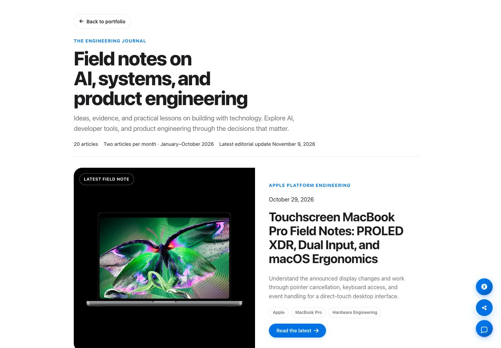     | 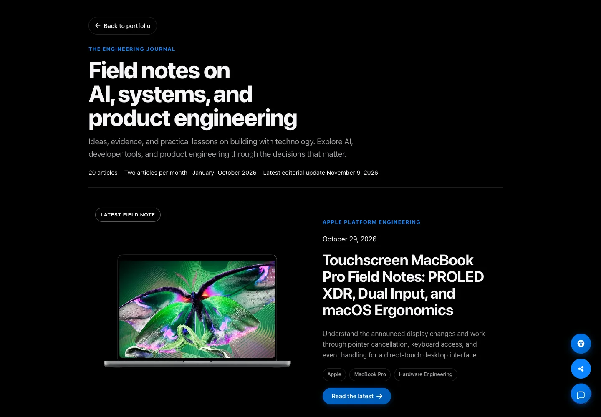     |
| Systems   | 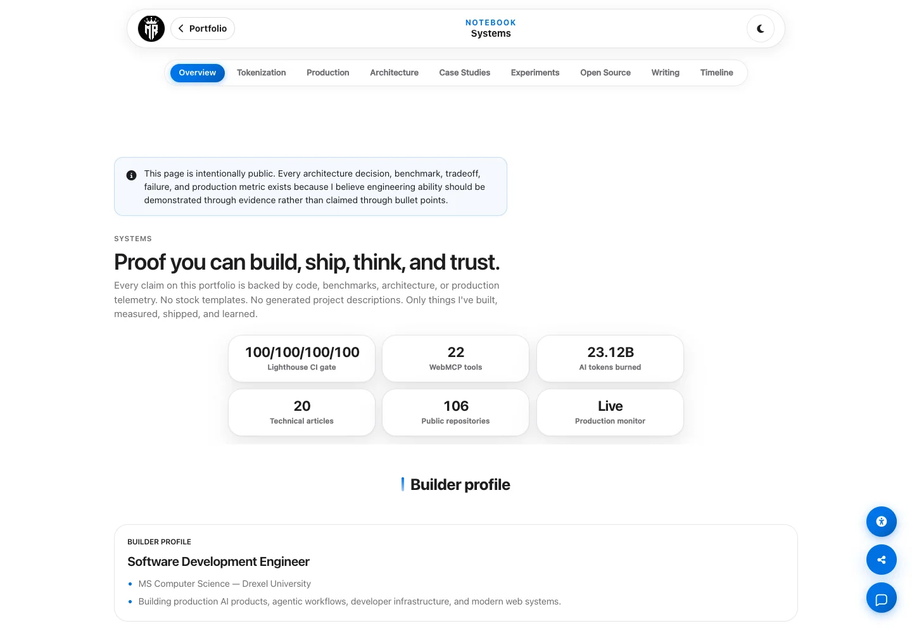     | 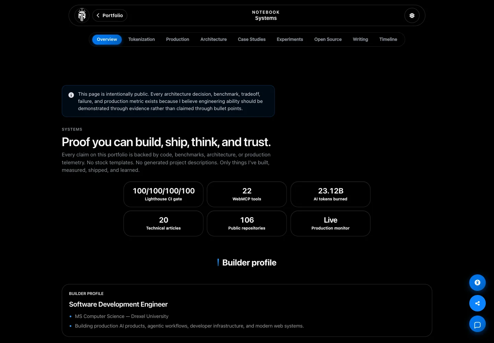     |
| Monitor   | 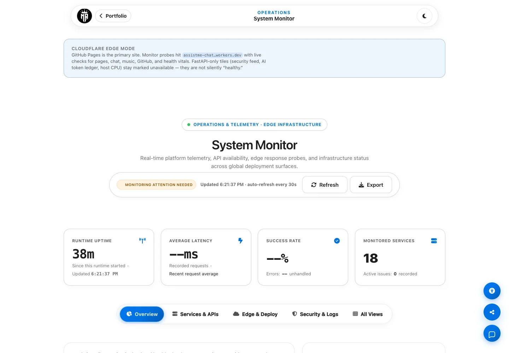     | 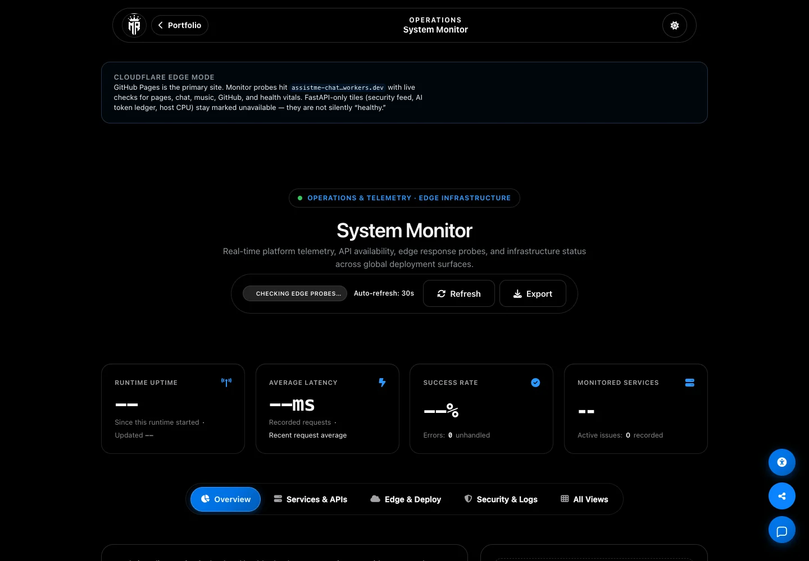     |
| Travel    | 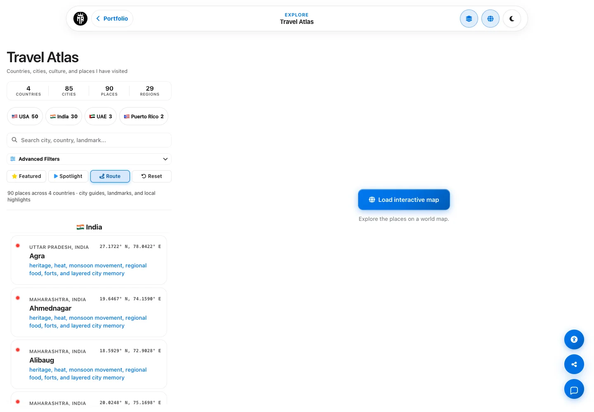       | 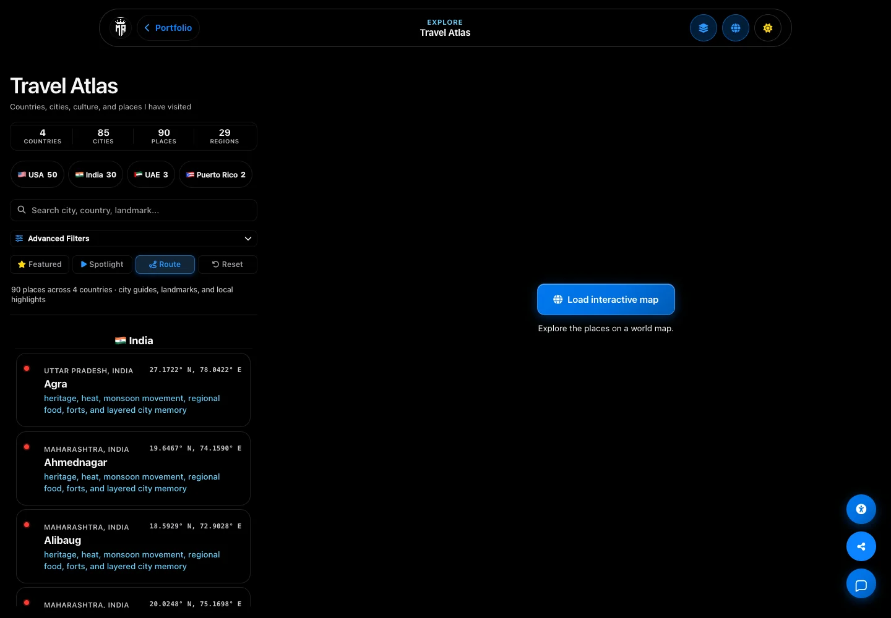       |
| Uses      | 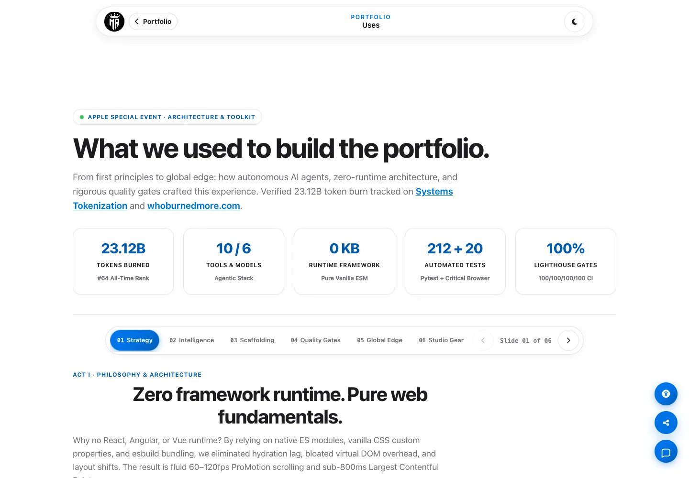           | 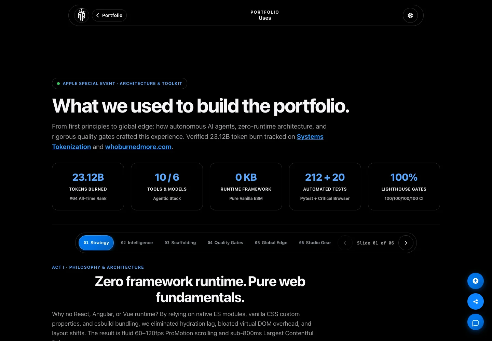           |
| Changelog | 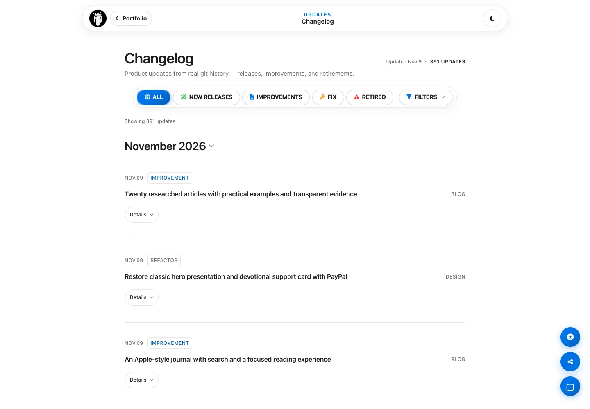 | 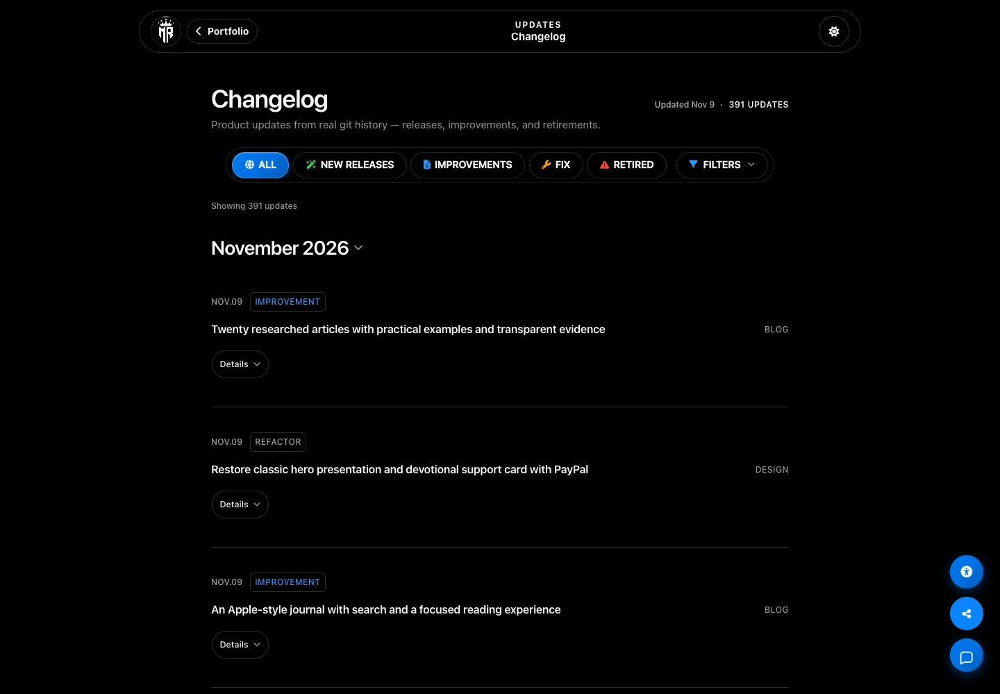 |

</details>

The design uses system typography, clear hierarchy, blue actions, visible focus states, and light/dark themes. [Design rules](docs/DESIGN.md) cover responsive layouts, motion, contrast, and controls. This independent portfolio is not affiliated with Apple.

## 2. How it works

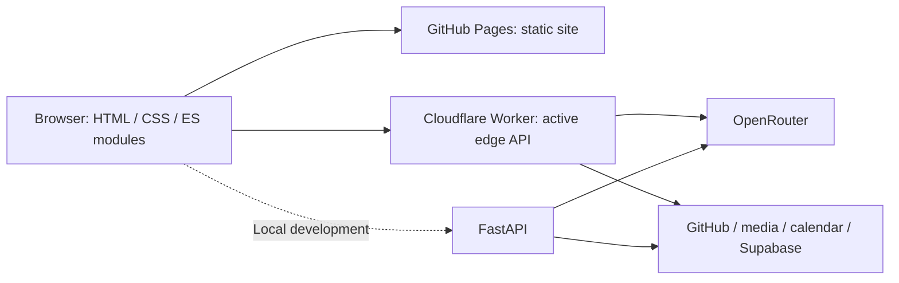

GitHub Pages hosts the production frontend. The Cloudflare Worker handles the active edge API. FastAPI provides local development and an optional serverless backend; the Vercel deployment is currently disabled. Chat streams from the API to the browser as newline-delimited JSON. Model selection belongs to the service configuration, not the client.

| Directory                                        | Responsibility                                                         |
| ------------------------------------------------ | ---------------------------------------------------------------------- |
| [src/](src/)                                     | Page shells, native ES modules, vanilla CSS, public data and media     |
| [workers/assistme-chat/](workers/assistme-chat/) | Edge routing, streaming, integrations, and provider recovery           |
| [api/](api/)                                     | FastAPI routes, model routing, monitoring, and OAuth integrations      |
| [scripts/](scripts/)                             | esbuild, asset generation, development, QA, and deployment tooling     |
| [tests/](tests/)                                 | API, Worker, unit, and browser regression coverage                     |
| [docs/](docs/)                                   | Design, architecture, operating guides, and dated verification records |

There is no client-side React, Vue, Angular, or Svelte runtime. Tailwind runs at build time; components use vanilla CSS. See [architecture](ARCHITECTURE.md) and the [folder map](docs/STRUCTURE.md).

## 3. Run locally

Use Node.js `>=22 <27` (Node 22 recommended), Python 3.12+, [uv](https://docs.astral.sh/uv/), and Git.

```bash
git clone https://github.com/mangeshraut712/mangeshrautarchive.git
cd mangeshrautarchive
npm ci
uv venv --python 3.12 venv
uv pip install --python venv/bin/python -r requirements.txt -r requirements-dev.txt
npm run doctor:strict
npm run dev
```

Open `http://127.0.0.1:4000`. FastAPI runs on port `8001`, with health at `/api/health` and local API documentation at `/api/docs`. Name the Python environment `venv` so the development runner discovers it. Stop both services with **Ctrl+C**.

Without `OPENROUTER_API_KEY`, local FastAPI returns clearly labeled canned portfolio answers. For real integrations, copy [.env.example](.env.example) to an ignored local environment file and configure only the services you use. Never put credentials in browser code or Git.

For browser tests, install Google Chrome: the configured Desktop Chrome project uses its `chrome` channel. Install other Playwright browsers when needed with `npx playwright install`. Calendar, voice, and media requirements are documented in the [API guide](docs/API.md).

## 4. Engineering and verification

```bash
npm run check                 # ESLint, Stylelint, Oxlint, Prettier
npm test                      # API + Worker + unit + critical Chrome journeys
npm run test:tester-army:ci    # Deterministic desktop journeys
npm run security-check        # Repository secret-pattern scan
npm run build                 # Production output in dist/
```

[Tests and coverage](tests/README.md) explain the suites; the [November 9 review](docs/qa/repository-review-2026-11-09.md) records this maintenance pass. GitHub Actions builds and deploys Pages after its quality gates. CodeQL analyzes JavaScript/TypeScript, Python, and Actions through GitHub default setup. A completed scan and a cleared alert list are separate checks.

**Performance evidence has a scope.** The deploy workflow requires 100/100/100/100 on its reduced audit-mode homepage, with rounded score thresholds. That gate does not establish raw 100s on every page, device, or normal live load. Use `lighthouse-gate.js --full-load` for normal-runtime measurement and retain the report and configuration. No universal live 100-score claim is made here.

**Media has provenance.** Blog images retain publisher credits and source links in the [media manifest](src/assets/data/blog-media-sources.json). Repository illustrations are labeled when conceptual. Third-party images retain their owners’ rights; this repository’s MIT license covers its code, not ownership of those images.

## 5. Maintenance and contribution

Start with [CONTRIBUTING.md](CONTRIBUTING.md), [AGENTS.md](AGENTS.md), and the [design system](docs/DESIGN.md). Keep changes focused, preserve existing work, and attach verification appropriate to the changed behavior. Report vulnerabilities privately through [SECURITY.md](SECURITY.md).

### 5.1 Coding agent and purpose

Mac calendar authorization (2026-11-13): GPT-6 / Codex adds a persistent native permission window and separates GUI and scheduled command lifecycles so macOS can authorize the installed helper. Exact model variant, reasoning mode, and token usage: unavailable.

Calendar activation diagnostics (2026-11-13): GPT-6 / Codex adds safe provider failure categories while preserving the last successful snapshot. Logs exclude credentials, feed URLs, account identifiers, and event content. Exact model variant, reasoning mode, and token usage: unavailable.

Automatic calendar sync (2026-11-13): GPT-6 / Codex implements separate Google account connections, private Luma subscription ingestion, and a permissioned macOS EventKit helper. The Worker publishes only Luma and explicitly public provider events, reconciles duplicate occurrences, and keeps reminders and pass references in an authenticated owner view. Activation and limitations are documented in [the calendar sync design](docs/plans/2026-11-13-calendar-auto-sync-design.md) and [Mac helper guide](scripts/integrations/calendar-helper/README.md). Exact model variant, reasoning mode, and token usage: unavailable.

Support QR options (2026-11-13): GPT-6 / Codex added a third Support My Work tab for the supplied UPI and Zelle images, with keyboard-accessible tab navigation and responsive QR frames. Exact model variant, reasoning mode, and token usage: unavailable.

Luma reconciliation (2026-11-13): GPT-6 / Codex verified 10 upcoming and 53 past entries in signed-in Safari, refreshed dates and RSVP states, replaced verified stale calendar copies, and added a Past filter without inferring attendance. Exact model variant, reasoning mode, and token usage: unavailable. This snapshot does not modify calendar accounts. Release verification also pins the repository-preview browser test to a fixed catalog fixture so external GitHub availability cannot remove its test subject.

Calendar refresh (2026-11-13): GPT-6 / Codex refreshed the local Apple Calendar snapshot, reconciled the full 2026 Google calendar and checked scheduled 2027 events, normalized occurrence timestamps to prevent duplicates, and removed seeded reminders after Apple Reminders and both signed-in Google Tasks accounts returned no items. The combined view has 156 entries, with verified renamed/rescheduled invitations consolidated. The second Google calendar was read through its Apple mirror; Exchange remains unavailable and its cached entries are marked as cached in the data. Exact model variant, reasoning mode, and token usage: unavailable. This is a website snapshot, not continuous two-way account synchronization; browser-created reminders remain local.

I maintain this portfolio with assistance from several coding tools. Each shipped change records its contributor and purpose in the [changelog](src/js/data/changelog-entries.js); earlier records are preserved in [development history](docs/DEVELOPMENT_HISTORY.md).

| This maintenance contribution              | Record                                                                                                                |
| ------------------------------------------ | --------------------------------------------------------------------------------------------------------------------- |
| Coding agent                               | Gemini 3.8 Flash / Google Antigravity IDE                                                                             |
| Purpose                                    | Harmonize GitHub Operating View metrics, layout, and document comprehensive system architecture and risk matrix       |
| Exact variant, reasoning mode, token usage | unavailable                                                                                                           |
| Chatbot runtime                            | Separate configuration in [FastAPI](api/model_router.py) and the [Worker](workers/assistme-chat/src/model-routing.js) |

The [project showcase audit](docs/qa/project-showcase-2026-11-10.md) records catalog accuracy, GitHub metadata handling, and device/theme verification.

The [persistent monitoring guide](docs/qa/durable-monitor-2026-11-09.md) describes the collector, retention, incident policy, and verification.

The [Monitor status redesign](docs/qa/monitor-status-2026-11-09.md) documents probe scope, freshness, and device/theme verification.

The [November 9 responsive audit](docs/qa/responsive-feature-audit-2026-11-09.md) records device/theme coverage, fixes, and verification limits.

## 6. Documentation

[Documentation index](docs/README.md) · [API](docs/API.md) · [Design](docs/DESIGN.md) · [Architecture](ARCHITECTURE.md) · [Tests](tests/README.md) · [Roadmap](TASKS.md) · [Status](PROGRESS.md)

Current guides and dated historical audits are indexed separately. Generated output, local reports, environments, and credentials stay out of source control. Website screenshots live under `docs/screenshots/` and do not add assets to the production bundle.

## 7. License and contact

Code is released under the [MIT License](LICENSE). See [CITATION.cff](CITATION.cff) for software citation metadata.

[Mangesh Raut](https://mangeshraut712.github.io/mangeshrautarchive/) · [GitHub](https://github.com/mangeshraut712) · [LinkedIn](https://www.linkedin.com/in/mangeshraut71298/) · [Contact](https://mangeshraut712.github.io/mangeshrautarchive/#contact)
