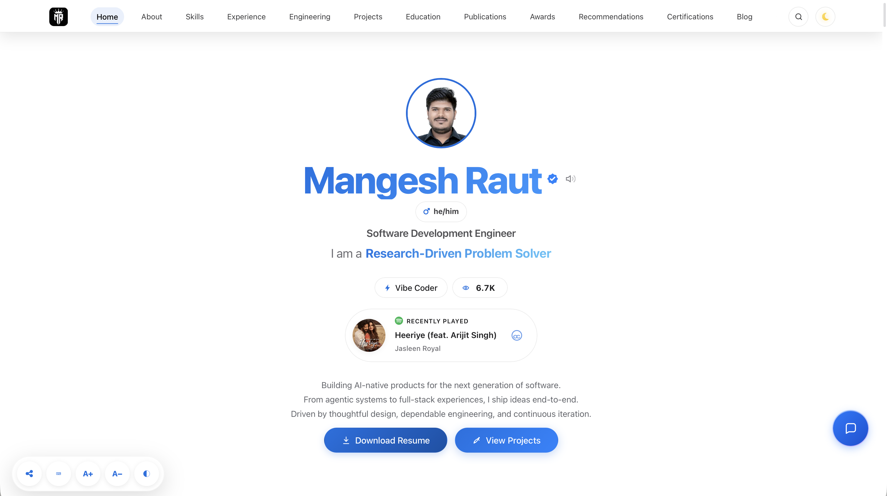
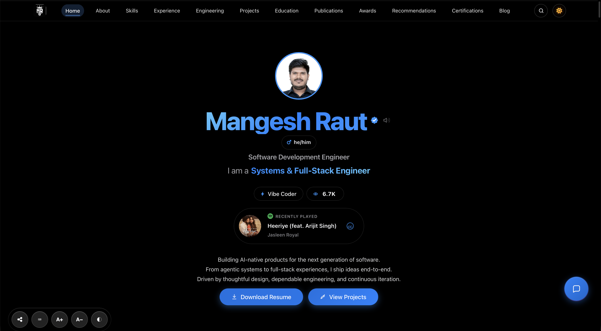
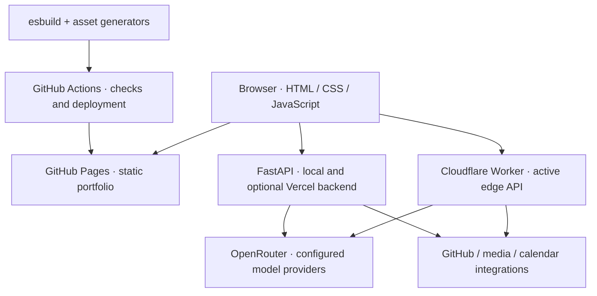

<div align="center">

# Mangesh Raut · Portfolio

**Software engineering, thoughtful design, and AI that can act.**

An open-source portfolio built with native web standards, an Apple-inspired interface,
and an agentic assistant. Explore the work, inspect the systems, or run the entire project locally.

<p>
  <a href="https://mangeshraut712.github.io/mangeshrautarchive/">Explore the portfolio</a> ·
  <a href="https://mangeshraut712.github.io/mangeshrautarchive/#projects">Projects</a> ·
  <a href="https://mangeshraut712.github.io/mangeshrautarchive/blog/">Writing</a> ·
  <a href="docs/README.md">Documentation</a>
</p>
<p>
  <a href="https://github.com/mangeshraut712/mangeshrautarchive/actions/workflows/deploy.yml"></a>
  <a href="package.json"></a>
  <a href=".python-version"></a>
  <a href="LICENSE"></a>
</p>

</div>

<table>
  <tr>
    <td width="50%"><a href="https://mangeshraut712.github.io/mangeshrautarchive/"></a></td>
    <td width="50%"><a href="https://mangeshraut712.github.io/mangeshrautarchive/"></a></td>
  </tr>
  <tr><td align="center"><strong>Light. Clear and spacious.</strong></td><td align="center"><strong>Dark. Focused and precise.</strong></td></tr>
</table>

Existing screenshots of the actual website. Live counters, music, and navigation can change.

---

[Experience](#1-the-experience) · [Architecture](#2-how-it-works) ·
[Run locally](#3-run-locally) · [Quality](#4-engineering-and-verification) ·
[Contributing](#5-maintenance-and-contribution) · [Documentation](#6-documentation) ·
[Contact](#7-license-and-contact)

## 1. The experience

This repository is the source for Mangesh Raut’s public portfolio: professional background,
projects, engineering case studies, publications, and writing, alongside the services that power
AssistMe and the site’s integrations.

| Surface                                                                         | What you can explore                                                                                                            |
| ------------------------------------------------------------------------------- | ------------------------------------------------------------------------------------------------------------------------------- |
| [Portfolio](https://mangeshraut712.github.io/mangeshrautarchive/)               | Background, skills, experience, education, projects, publications, awards, recommendations, certifications, résumé, and contact |
| [Projects](https://mangeshraut712.github.io/mangeshrautarchive/#projects)       | GitHub repository cards, real README screenshots, repository facts, filters, and detailed previews                              |
| [Systems](https://mangeshraut712.github.io/mangeshrautarchive/systems.html)     | Architecture, engineering workflows, case studies, and technical decisions                                                      |
| [Monitor](https://mangeshraut712.github.io/mangeshrautarchive/monitor.html)     | Service health, operational telemetry, and runtime diagnostics                                                                  |
| [Writing](https://mangeshraut712.github.io/mangeshrautarchive/blog/)            | 20 articles across January–October 2026, with two articles per month, source references, and credited media                     |
| [Travel](https://mangeshraut712.github.io/mangeshrautarchive/travel.html)       | Interactive travel atlas, route views, location stories, and a globe loaded on request                                          |
| [Uses](https://mangeshraut712.github.io/mangeshrautarchive/uses.html)           | Development tools, hardware, AI workflow, and the stack behind the site                                                         |
| [Changelog](https://mangeshraut712.github.io/mangeshrautarchive/changelog.html) | Releases, fixes, model attribution, and verified commit links                                                                   |

### AssistMe: an assistant inside the portfolio

AssistMe connects conversation to the website. It supports streaming responses, Markdown,
syntax-highlighted code, mathematical notation, attachments, voice interfaces, conversation memory,
and browser-side WebMCP actions for navigating and retrieving portfolio information.

- **Grounded answers:** portfolio context is assembled from repository data and site knowledge.
- **Tools:** browser actions are implemented in [agentic-actions.js](src/js/modules/agentic-actions.js).
- **Model routing:** provider selection is configured in the backend and Worker; the FastAPI router
  uses the configured OpenRouter primary model. The live Worker routes by task and input capability,
  using Nemotron Ultra for reasoning, Nemotron Lightning for quick turns, North Mini Code for code,
  and compatible Gemma/Omni models for media. Catalog capabilities refresh hourly.
- **Offline development:** the local FastAPI backend provides canned portfolio answers when
  `OPENROUTER_API_KEY` is absent. Real model responses require provider credentials.

Model availability and integration behavior depend on runtime configuration. See the
[API guide](docs/API.md) for routes, environments, and differences between deployments.

### Project and editorial integrity

Repository cards use GitHub metadata and available README screenshots. Repositories without a
suitable screenshot can show a clearly labeled conceptual illustration. Coverage counts are dated
snapshots, documented in the [repository screenshot audit](docs/REPO_SCREENSHOT_COVERAGE.md) and
[asset manifest](src/assets/images/repo-screenshots/manifest.json).

Blog media is traced to original publishers where available, with visible credits and a documented
conceptual fallback. The [media audit](docs/BLOG_MEDIA_AUDIT.md) and
[source manifest](src/assets/data/blog-media-sources.json) record provenance and verification.

### Contact, world clocks, and calendar

Direct Outreach includes live analog clocks for New York, London, Mumbai, Tokyo, Sydney, and Paris,
using IANA timezones with daylight-saving handling. Three clocks are shown initially, with the other three available through View more. Calendar events show five compact cards by default and expand into a bounded scrolling panel;
personal reminders can be reviewed, saved in the browser, and exported as one-time calendar copies.

Today’s Panchang is sourced from [Kalnirnay](https://www.kalnirnay.com/). A scheduled workflow checks
the official publication hourly, using a dated cache key to avoid yesterday’s cached response.
The frontend checks the snapshot every 15 minutes while visible and displays only values dated today
in India. If fresh values are unavailable, it hides stale data and links to the official calendar.

**Source limitation:** the October 2 local fetch returned verified current values, but Kalnirnay
returned HTTP 403 to GitHub’s hosted runner. The scheduled workflow reports that refusal as a warning;
a successful workflow does not guarantee fresh data. Automatic daily ingestion remains dependent on
the publisher permitting the runner’s requests. See the
[contact calendar implementation notes](docs/CONTACT_CALENDAR.md).

### Design and accessibility

The interface follows an Apple-inspired visual language: system typography, restrained spacing,
blue primary actions, solid white neutral surfaces in light mode, and solid black neutral surfaces
in dark mode. Borders define cards and grouped controls; category and brand icons retain their colors. Shared design
rules include visible keyboard focus, circular red close controls, reduced-motion support,
accessible contrast, and layouts without horizontal overflow.

The [design system](docs/DESIGN.md) defines the tokens and component behavior. This is an independent
portfolio; it is not an Apple product or an Apple-affiliated project.

## 2. How it works



GitHub Pages serves the production frontend. The active Cloudflare Worker provides edge API
services. FastAPI powers local development and the optional Vercel deployment path. Static hosting
does not execute Python; API requests use the configured service endpoint.

| Layer           | Implementation                                                       | Source                                           |
| --------------- | -------------------------------------------------------------------- | ------------------------------------------------ |
| Interface       | Semantic HTML, vanilla CSS, native JavaScript ES modules             | [src/](src/)                                     |
| Styling         | CSS custom properties, system font stacks, Tailwind v4 build output  | [src/assets/css/](src/assets/css/)               |
| Build           | esbuild, generated blog pages, metadata, icons, and optimized assets | [scripts/build/](scripts/build/)                 |
| Edge services   | Cloudflare Worker                                                    | [workers/assistme-chat/](workers/assistme-chat/) |
| Python services | FastAPI, route modules, model routing, and integrations              | [api/](api/)                                     |
| Rich responses  | Marked, DOMPurify, syntax highlighting, and KaTeX                    | [package.json](package.json)                     |
| Verification    | pytest, Playwright, accessibility checks, and Lighthouse             | [tests/](tests/)                                 |
| Delivery        | GitHub Actions, Pages, and separate Worker deployment                | [.github/workflows/](.github/workflows/)         |

The frontend has no React, Angular, Vue, or Svelte runtime. Tailwind is used during the build;
component styling lives in vanilla CSS rather than utility classes in HTML.

<details>
<summary><strong>Repository map</strong></summary>

```text
src/                     Frontend pages, ES modules, styles, media, and public data
api/                     FastAPI application, routes, model router, and integrations
workers/assistme-chat/   Cloudflare edge API
scripts/                 Build, development, QA, security, and deployment tooling
tests/api/               Python API tests
tests/e2e/               Browser user journeys and broader regression coverage
docs/                    Design, architecture, API guides, and audit evidence
.github/workflows/       CI, publication, monitoring, and data synchronization
dist/                    Generated production output; ignored by Git
```

See [STRUCTURE.md](docs/STRUCTURE.md) for the complete directory guide.

</details>

## 3. Run locally

**Prerequisites:** Git, Node.js `>=22 <27` (Node 22 recommended), Python 3.12+, and
[uv](https://docs.astral.sh/uv/). The repository’s `.nvmrc` selects Node 22.

```bash
git clone https://github.com/mangeshraut712/mangeshrautarchive.git
cd mangeshrautarchive

npm ci
uv venv --python 3.12 venv
uv pip install --python venv/bin/python -r requirements.txt -r requirements-dev.txt
npx playwright install chromium

npm run doctor:strict
npm run dev
```

| Local service                 | Address                            |
| ----------------------------- | ---------------------------------- |
| Portfolio                     | `http://127.0.0.1:4000`            |
| API health                    | `http://127.0.0.1:8001/api/health` |
| Interactive API documentation | `http://127.0.0.1:8001/api/docs`   |

Use `venv` as the environment directory: the development backend detects its Python interpreter.
Stop the development server with **Ctrl+C**. To run the configured Desktop Chrome tests, install
Google Chrome; the Playwright configuration explicitly selects its `chrome` channel.

### Configuration and integrations

A local demo does not require API credentials. For real services, copy `.env.example` to an ignored
local environment file and fill only the integrations you intend to use.

- `OPENROUTER_API_KEY` enables real model responses in FastAPI.
- `OPENROUTER_MODEL` optionally selects the backend model.
- GitHub, music, health, and calendar services have their own configuration requirements.
- Google Calendar booking and the local Apple/Outlook `.ics` fallback have different behavior;
  consult the [API guide](docs/API.md) before configuring them.

Never commit environment files, credentials, or private calendar data. Browser fallback reminders
and exported calendar files do not grant access to an Apple account.

## 4. Engineering and verification

| Command                       | Purpose                                                                         |
| ----------------------------- | ------------------------------------------------------------------------------- |
| `npm run dev`                 | Start frontend and FastAPI development services                                 |
| `npm run dev:frontend`        | Run the frontend with the local API proxy                                       |
| `npm run dev:backend`         | Run FastAPI independently                                                       |
| `npm run doctor:strict`       | Validate repository layout and stack constraints                                |
| `npm run check`               | ESLint, Stylelint, anti-slop checks, and formatting                             |
| `npm test`                    | Run API, Worker, unit, and critical Playwright tests                            |
| `npm run test:worker`         | Run Cloudflare Worker multimodal routing and stream boundary tests              |
| `npm run test:tester-army`    | Run 23 deterministic Tester Army journeys across Chromium and WebKit (46 tests) |
| `npm run test:tester-army:ci` | Run 23 deterministic Tester Army journeys on desktop Chromium for CI            |
| `npm run test:e2e:all`        | Run the broader Playwright suite across 16 configured browser projects          |
| `npm run security-check`      | Scan source files for exposed secrets and credentials                           |
| `npm run build`               | Generate production output in `dist/`                                           |
| `npm run qa:surfaces`         | Smoke-check configured deployment surfaces                                      |
| `npm run qa:postdeploy`       | Check configured host availability and commit parity                            |

### Evidence, not permanent guarantees

The October 24, 2026 release passed **192 API tests, 20 Worker routing/stream boundary tests, 14 critical Chrome journeys, and 23 Tester Army journeys (46 browser checks across desktop Chromium and mobile WebKit)**.
ESLint, Stylelint, formatting, the secret scan, and the production build passed locally.
The matching deployment workflow passed its quality, Lighthouse, Pages publication, and deployment verification gates. The Lighthouse gate uses the reduced `perf-audit` page and applies score rounding; it is not a measurement of a normal page load.
These are dated results for that release, not guarantees about every browser or future deployment.

For a production-like Lighthouse run, pass `--full-load` to `scripts/deployment/lighthouse-gate.js` and inspect the raw category scores in the generated JSON report. Audit-mode and loopback gate output can round scores up, and local SEO results may be adjusted for a loopback robots.txt issue. Lab scores vary between runs and are not field Core Web Vitals.

The [November 1 Lighthouse evidence](docs/qa/2026-11-01-lighthouse-evidence.md) records raw samples, test conditions, and a reproducible command.

Responsive review covered Home, Systems, Travel, Monitor, Uses, and Changelog at desktop and phone
widths in both themes, with no horizontal overflow in the reviewed states. The deployed contact card
was checked for current Panchang values and category icon colors. Share-card alignment and AssistMe’s
composer and viewport bounds were also reviewed. This does not claim the broader 16-project browser
suite passed. The [October 1 site audit](docs/SITE_AUDIT_2026-10-01.md) preserves earlier review scope.

### Release path

1. Run the required local gates: `npm run check`, `npm test`, `npm run security-check`, and `npm run build`.
2. Commit reviewed changes with a conventional commit message and update release attribution.
3. Push `main`; verify the matching GitHub Actions runs and Pages publication finish successfully.
4. Check the deployed routes and asset version. A passing local build alone does not prove deployment.

GitHub Pages is the primary public host. Vercel is an optional deployment path; its live availability
must be checked separately. Worker changes follow their dedicated deployment workflow.

## 5. Maintenance and contribution

Read [CONTRIBUTING.md](CONTRIBUTING.md), [AGENTS.md](AGENTS.md), and the relevant design or architecture
guide before making changes. Keep fixes focused, preserve the native web stack, and add realistic
browser coverage when user behavior changes. Use the four local release gates above before submitting.

### Tester Army browser journeys

Run `npm run test:tester-army` with Node 22.12+ after `npx playwright install chromium webkit`.
The pinned `e2e@0.21.2` and `@e2e-dev/web@0.11.2` suite runs 23 journeys on desktop Chromium
and mobile WebKit without a model or API key. The runner starts the frontend on a free port and cleans
up its own process. Use `E2E_APP_URL` for an existing local server. See
[the coverage manifest](docs/TESTER_ARMY.md) for assertions and external-service limits.
The JavaScript config is selected explicitly because upstream automatic discovery uses TypeScript filenames.

### 5.1 Coding agents and provenance

**Journal reading experience:** GPT-6 / Codex desktop; purpose: improve all 20 article layouts, add archive search and sorting, preserve credited media and evidence links, and correct article-body reading progress. Exact model variant, reasoning mode, and token usage: unavailable. Focused verification: `tests/e2e/blog-reader.spec.js` (22 cases covering all articles and discovery controls).

**Apple Music iOS 27.2 monochrome design, sub-1s scrobble sync, Currently shelf real-time hydration, and WCAG AA contrast:** Gemini 3.8 Flash, in Google Antigravity IDE; purpose: resolve Last.fm scrobble latency by prioritizing authentic Last.fm CDN images over synchronous external iTunes queries in api/routes/media.py, slashing response times from >5s to <200ms; eagerly hydrate the Currently music shelf directly from Cloudflare Worker and local caches to eradicate solitary "No live playback" states; enforce iOS 27.2 monochrome Apple Music button design (pure black in light mode, pure white in dark mode, zero red) on solid #ffffff and #000000 card backgrounds without dull grey; and lock commercial advisory badge color contrast to 7.2:1 with #0056b3/#ffffff, passing all Axe accessibility gates. Exact model variant, reasoning mode, and token usage: unavailable.

**Recruiter Quick-Action Strip, Reverse Technical Interview Sandbox, Commercial Advisory, and Full GA4 Telemetry:** Gemini 3.8 Flash, in Google Antigravity IDE; purpose: deploy Hero Recruiter Quick-Action Strip with availability vitals, 1-click USA resume download, and 15m screen booking; deploy interactive "Reverse Technical Interview" evaluation sandbox with live architecture prompt chips connected to AssistMe; transform support section into high-value commercial "1:1 Architecture & AI Systems Advisory ($250 / 45-min session)" with Stripe checkout alongside open-source tips; and wire full GA4 conversion telemetry to all checkout channels (Stripe, PayPal, BMC, GitHub Sponsors), contact form submissions, newsletter subscriptions, and recruiter quick-actions. Exact model variant, reasoning mode, and token usage: unavailable.

**Apple Music iOS 27.2 monochrome design, 1s scrobble sync, Currently shelf parity, and 44px touch targets:** Gemini 3.8 Flash, in Google Antigravity IDE; purpose: modernize Apple Music button to iOS 27.2 monochrome design (pure black in light mode, pure white in dark mode, no red) on solid pure backgrounds with zero grey surfaces, eliminate the solitary "No live playback" void on Currently music shelf via immediate hydration from cache or curated tracks and eager preloading, implement 1-second ultra-low latency Last.fm scrobble syncing with direct Cloudflare Edge Worker failover, synchronize Currently shelf and Hero Music Card in real time, enforce strict vinyl rotation physics (spins strictly when playing or previewing, strictly stationary when idle), resolve offline dark button contrast to WCAG 2 AA (>4.6:1), and unify 44px Apple HIG touch targets across all surfaces. Exact model variant, reasoning mode, and token usage: unavailable.

**Debug Runner endless mode high scoring and leaderboard tracking:** Gemini 3.8 Flash, in Google Antigravity IDE; purpose: enable endless Normal mode loop progression past 1,000m allowing score to scale past 5,000, 10,000, and 50,000+ points without premature rooftop reset pedestal triggering (scoped strictly to Hard and Nightmare modes). Add stage loop indicator toast notifications, unclamp distance display in deployment failed card, expose window.debugRunnerGame handle, and verify 5,010, 10,020, and 50,020 automated playthroughs populating Top 3 leaderboard in light and dark themes. Exact model variant, reasoning mode, and token usage: unavailable.

**Debug Ascent: Rooftop Reset Edition and Apple Arcade upgrade:** Gemini 3.8 Flash, in Google Antigravity IDE; purpose: major Apple Arcade upgrade to the developer portfolio runner (`#debug-runner-section`) integrating mechanics from `poteto.com`'s viral Rooftop Reset. Features 3 difficulty tiers (Normal endless, Hard with stage checkpoints at 8.6x speed, Nightmare with 0 checkpoints at 10.5x speed resetting to localhost basement on collision), invulnerable Air Dash (Shift / X / D or mobile button with cyan particle trail and ground refueling cooldown), 6 cloud architecture ascending floors (Localhost -> Staging CI -> Code Review -> Kubernetes -> Global CDN -> Production Rooftop), oscillating titanium saws, duckable laser beams, hydraulic compiler compression gates, and an elevated glass pedestal with glowing red RESET button at 1,000m triggering victory state with clear time and death counter. Styled with Apple HIG frosted glass cards, native segmented pill difficulty switcher, tactile mobile controls (`SLIDE`, `DASH`, `JUMP` with specular shine), and sandbox-safe storage. Exact model variant, reasoning mode, and token usage: unavailable.

**Currently music shelf pre-hydration, zero-void resilience, and 1.5s scrobble sync:** Gemini 3.8 Flash, in Google Antigravity IDE; purpose: pre-render 6 rich curated tracks directly in HTML on the Currently music shelf, eliminate loading wipes and lonely empty-card voids in `start()` and `showLoadingState()`, accelerate live scrobble sync to 1.5s (3.5s idle) with direct Edge Worker fallback, enforce iOS 27.2 monochrome Apple Music branding, and guarantee spinning artwork strictly tracks active playback. Exact model variant, reasoning mode, and token usage: unavailable.

**WhoBurnedMore 23.12B telemetry sync, compact music card, and instant shelf hydration:** Gemini 3.8 Flash, in Google Antigravity IDE; purpose: synchronize WhoBurnedMore 23.12B tokens ($19,649 spend, rank #64 / 358 devs, 254 active days) across Systems, Uses, and Monitor surfaces, reduce hero music card width to 324px (312px mobile) for tighter visual balance, fix vinyl artwork hover rotation physics, eliminate Currently shelf loading void via instant hydration, and lower Last.fm scrobble latency to 2s. Exact model variant, reasoning mode, and token usage: unavailable.

**Live GitHub profile and metrics synchronization:** Gemini 3.8 Flash, in Google Antigravity IDE; purpose: synchronize public repositories (108 total, 42 original non-fork repos + 66 forks), total stars (13: 8 on Gravity-SaaS-Agent, 3 on Stanford-CS336, 1 on Dotfit-Fitness, 1 on mangeshrautarchive), total forks (4), followers (15), following (8), and 2026 contributions (4,865) directly from GitHub API via authenticated gh CLI. Elevate prominent starred projects in featured portfolio order, update systems overview metrics, and harden regressions test timing. Exact model variant, reasoning mode, and token usage: unavailable.

**Apple Music iOS 27.2 monochrome design and 5s scrobble sync:** Gemini 3.8 Flash, in Google Antigravity IDE; purpose: transition Apple Music icon from red to iOS 27.2 monochrome (solid black in light theme, pure white in dark theme), eliminate grey backgrounds in favor of solid pure white and black, enforce strict artwork spin when playing vs paused when idle, and reduce Last.fm sync latency from 25s down to 5s with instant tab/focus triggers. Exact model variant, reasoning mode, and token usage: unavailable.

**Resilient music edge proxy and curated fallback:** Gemini 3.8 Flash, in Google Antigravity IDE; purpose: eliminate empty music placeholder void and subtitle text truncation across hero music card and Currently music shelf via edge worker proxy fallback, curated playlist ("Hale Dil", "Main Yahaan Hoon", "Aadat", "Deewaana Deewaana", "Teri Deewani", "Aap Ki Kashish", "Kaho Na Kaho", "Zara Zara") with authentic artwork and 30s previews, and local development edge proxy. Exact model variant, reasoning mode, and token usage: unavailable.

**Music card brand colors and preview APIs:** Gemini 3.8 Flash, in Google Antigravity IDE; purpose: enforce authentic brand colors across all browsers (Spotify Green `#1DB954`, Apple Music Pink/Red `#FA243C`, Apple Blue `#0071e3` Play button), fix light and dark theme CSS color cascades for preview tag and timestamps satisfying WCAG 2 AA contrast, and enhance FastAPI backend media endpoints (`/api/music/artwork`, `/api/music/details`, `/api/music/preview`) to resolve and return full rich iTunes metadata with 30-second audio preview streams. Exact model variant, reasoning mode, and token usage: unavailable.

**Music card compact proportions and vinyl rotation:** Gemini 3.8 Flash, in Google Antigravity IDE; purpose: right-size hero music card container width (352px) narrower than hero sections below, restore spinning vinyl artwork rotation whenever music is actively playing or previewing, and refine Spotify and Apple Music hover states while guaranteeing 44px touch targets. Exact model variant, reasoning mode, and token usage: unavailable.

**System-theme tab icons and music controls:** GPT-6 / Codex desktop; purpose: keep browser favicons legible in both OS themes with explicit contrasting icon backgrounds, enlarge music artwork and symbols, and preserve accessible hit areas around smaller visible controls. Exact model variant, reasoning mode, and token usage: unavailable.

**Compact music player:** GPT-6 / Codex; purpose: compact the hero music card, place controls at the upper right, and bind artwork rotation to preview playback. Exact model variant, reasoning mode, and token usage: unavailable.

**Tester Army contribution:** GPT-6.1 Sol / Codex; purpose: deterministic browser journeys and coverage boundaries. Reasoning mode and token usage: unavailable. Independent verification uses GPT-6 Luna / Codex.

**Responsive audit fixes:** GPT-6 / Codex desktop; purpose: stabilize first paint and improve travel navigation and contact contrast. Exact variant, reasoning mode, and token usage: unavailable.

**Full-load performance work:** GPT-6 / Codex desktop; purpose: reduce startup work and measure real page loads while preserving the responsive interface. Exact variant, reasoning mode, and token usage: unavailable.

**Animation scheduling:** GPT-6 / Codex desktop; purpose: batch offscreen animation checks and retain newly added elements. Exact variant, reasoning mode, and token usage: unavailable.

**Style loading and accessibility:** GPT-6 / Codex desktop; purpose: prevent redundant stylesheet work and align accessible names with visible labels. Exact variant, reasoning mode, and token usage: unavailable.

**Dependency and audit review:** GPT-6 / Codex desktop; purpose: align Python dependency pins, address a test hostname finding, and document score limitations. Exact variant, reasoning mode, and token usage: unavailable.

**Frontend characterization:** GPT-6 / Codex desktop; purpose: cover the asset-version contract and hero flyout behavior with focused Node tests. Exact variant, reasoning mode, and token usage: unavailable.

**Lighthouse evidence:** GPT-6 / Codex desktop; purpose: record raw lab results and their measurement limits. Exact variant, reasoning mode, and token usage: unavailable.

**Sitewide score record:** GPT-6 / Codex desktop; purpose: document full-load mobile and desktop measurements for each published URL. Exact variant, reasoning mode, and token usage: unavailable.

**Portfolio fact corrections:** GPT-6 / Codex desktop; purpose: correct stale references and score labels, and fit case-study metrics on narrow screens. Exact variant, reasoning mode, and token usage: unavailable.

**WebMCP compatibility:** GPT-6 / Codex desktop; purpose: support the current document API and add read-only blog and case-study tools. Exact variant, reasoning mode, and token usage: unavailable.

**Worker deployment repair:** GPT-6 / Codex desktop; purpose: resolve the Wrangler dependency conflict in the Worker deployment workflow. Exact variant, reasoning mode, and token usage: unavailable.

**Deep-link alignment:** GPT-6 / Codex desktop; purpose: keep initial homepage section links aligned as content loads and respect visitor scrolling. Exact variant, reasoning mode, and token usage: unavailable.

**Portrait and icon sizing:** GPT-6 / Codex desktop; purpose: align responsive image metadata and reserve Experience icon dimensions before their stylesheet loads. Exact variant, reasoning mode, and token usage: unavailable.

**Desktop Contact startup:** GPT-6 / Codex desktop; purpose: prepare existing disclosure controls before direct Contact navigation settles. Exact variant, reasoning mode, and token usage: unavailable.

**Deep-link music loading:** GPT-6 / Codex desktop; purpose: defer offscreen homepage music on section deep links until Home is visible. Exact variant, reasoning mode, and token usage: unavailable.

**Music artwork sizing:** GPT-6 / Codex desktop; purpose: reduce the Last.fm image payload for the compact hero disc while retaining high-density display coverage. Exact variant, reasoning mode, and token usage: unavailable.

**First-paint styles:** GPT-6 / Codex desktop; purpose: apply existing layout styles before page load to reduce late style recalculation. Exact variant, reasoning mode, and token usage: unavailable.

**Mobile Contact startup:** GPT-6 / Codex desktop; purpose: prepare existing section disclosures earlier for mobile Contact links and measure layout stability. Exact variant, reasoning mode, and token usage: unavailable.

**First-visit greeting:** GPT-6 Astra / Codex desktop; purpose: run the greeting during loading, release ready content independently of the application bundle, and parse the complete hero before loading its badge enhancements. Localhost and automation use the same first-visit behavior as production. Reasoning mode and token usage: unavailable.

**Input-aware loading:** GPT-6 Astra / Codex desktop; purpose: prevent scripted scrolling from starting analytics early and load Contact widgets when relevant. GA4 configuration, queued events, idle fallback, and page-exit loading remain covered by regression tests. Reasoning mode and token usage: unavailable.

**Shared layout delivery:** GPT-6 Astra / Codex desktop; purpose: stabilize shared styles before first paint, reduce repeated layout work, and correct Lighthouse browser selection. Reasoning mode and token usage: unavailable. Normal-load verification remains in progress; this is not a claim of universal 100 scores.

**Contact style warm-up:** GPT-6 / Codex desktop; purpose: prevent offscreen section styles from shifting a direct Contact link during idle loading. Exact variant, reasoning mode, and token usage: unavailable.

Mangesh Raut maintains this portfolio with contributions from Codex, Claude Code, Google Antigravity,
Cursor, and GitHub Copilot. Shipped changes record the exposed agent/model family, engineering
purpose, and verified commit in the [changelog](src/js/data/changelog-entries.js).

| Current contribution                             | Attribution                                                                                                                                                                              |
| ------------------------------------------------ | ---------------------------------------------------------------------------------------------------------------------------------------------------------------------------------------- |
| Coding agent                                     | Composer, in Cursor                                                                                                                                                                      |
| Purpose                                          | Live WhoBurnedMore telemetry refresh (22.89B tokens, #61 of 357), cross-surface Systems/Uses/Monitor sync, smoke assertion alignment, and sync-whoburnedmore.mjs formatting hardening    |
| Exact model variant, reasoning mode, token usage | unavailable                                                                                                                                                                              |
| Portfolio chatbot model                          | Configured separately in [api/model_router.py](api/model_router.py) and [Worker configuration](workers/assistme-chat/wrangler.toml); each live response reports the actual serving model |

**Analytics workflow token review:** GPT-5 / Codex desktop; purpose: limit the review-artifact workflow to read-only repository access. Exact variant, reasoning mode, and token usage: unavailable.

**AssistMe verification — October 3, 2026:** GPT-6 / Codex in Codex desktop; purpose: live multimodal verification, accurate model labels, billing provenance, and responsive chatbot reliability. Exact variant, reasoning mode, and token usage: unavailable.

AssistMe on GitHub Pages uses the Cloudflare Worker at
`https://assistme-chat.mangeshraut712.workers.dev`. The frontend checks `/api/chat/health`
and sends chat requests to `/api/chat` on that host. An unavailable AI provider falls back to
explicitly labeled local answers. Interrupted streams discard the failed attempt before trying
another model; provider token usage is retained when supplied, and estimates remain labeled.
The chat window uses the available area below navigation, with a scrolling transcript and a
reachable composer. The deployed-host browser regression covers routing, fallback resets, and
final-frame metadata in Chrome and Safari. It is included in the 18-journey critical Chrome
release gate; Safari is also checked separately when changing this path.

Coding attribution in historical entries is contributor-reported in commit messages. A verified
commit link confirms the repository reference; it does not authenticate the actual model runtime.
Missing model, tool, reasoning, or token records are not inferred. See the
[changelog attribution audit](docs/CHANGELOG_ATTRIBUTION_AUDIT.md).

Previous contributor records are preserved in
[Development history](docs/DEVELOPMENT_HISTORY.md), with dated context for superseded implementations.

### Security, privacy, and responsible reuse

Provider credentials belong in backend or deployment secret stores. Public calendar endpoints expose
sanitized availability, while integration setup and private account data require protected server
configuration. Optional integrations and analytics should be reviewed before deploying your own copy.

Report vulnerabilities through [SECURITY.md](SECURITY.md). See [.env.example](.env.example) for the
configuration template. Replace personal profile data, contact destinations, OAuth settings, and
analytics identifiers when adapting this repository.

## 6. Documentation

| Guide                                                   | Purpose                                                            |
| ------------------------------------------------------- | ------------------------------------------------------------------ |
| [PRD](PRD.md)                                           | Product vision, target user personas, and functional requirements  |
| [Architecture](ARCHITECTURE.md)                         | Tech stack, directory map, Mermaid sequence, and data flow         |
| [Design blueprint](DESIGN.md)                           | Apple HIG tokens, typography, components, and vibe                 |
| [Rules & boundaries](RULES.md)                          | Coding style, security boundaries, and AI guardrails               |
| [Tasks roadmap](TASKS.md)                               | Phased, incremental, step-by-step implementation tasks             |
| [Progress log](PROGRESS.md)                             | Completed deliverables, resolved incidents, and current status     |
| [Documentation index](docs/README.md)                   | Start here for deeper implementation notes                         |
| [Design system](docs/DESIGN.md)                         | Visual tokens, components, accessibility, and responsive behavior  |
| [Architecture practices](docs/BEST_PRACTICES.md)        | Module boundaries, engineering conventions, and release discipline |
| [Repository structure](docs/STRUCTURE.md)               | Directory map and ownership                                        |
| [Tester Army manifest](docs/TESTER_ARMY.md)             | Tester Army deterministic browser journey coverage and boundaries  |
| [API guide](docs/API.md)                                | Routes, integrations, environments, and runtime differences        |
| [Site audit](docs/SITE_AUDIT_2026-10-01.md)             | October 2026 visual and functional verification                    |
| [Screenshot coverage](docs/REPO_SCREENSHOT_COVERAGE.md) | Dated repository image coverage and fallback rules                 |
| [Blog media audit](docs/BLOG_MEDIA_AUDIT.md)            | Original-source media and provenance                               |
| [Development history](docs/DEVELOPMENT_HISTORY.md)      | Preserved contributor attribution and historical decisions         |
| [Design audit skills](.agents/skills/)                  | Apple HIG critique, responsive audit, and animation motion skills  |

## 7. License and contact

The repository’s original code is released under the [MIT License](LICENSE). Third-party images,
logos, music artwork, and publisher media retain their respective rights; consult the source credits
before reuse. Citation metadata is provided in [CITATION.cff](CITATION.cff).

**Mangesh Raut** · [Website](https://mangeshraut712.github.io/mangeshrautarchive/) ·
[GitHub](https://github.com/mangeshraut712) ·
[LinkedIn](https://www.linkedin.com/in/mangeshraut71298) ·
[Email](mailto:mbr63@drexel.edu)

<div align="center">

[Back to top](#mangesh-raut--portfolio)

</div>

### AssistMe text model verification — October 2, 2026

The live text primary is [Nemotron 3 Ultra free](https://openrouter.ai/nvidia/nemotron-3-ultra-550b-a55b:free). OpenRouter's live catalog reports zero prompt and completion token prices. An authenticated inference probe returned HTTP 200, the exact requested model ID, and zero cost. Nemotron Super remains the next free fallback. Ultra is text-only; image requests retain the existing free vision chain. Local/server environment overrides remain explicit.

[NVIDIA's model release](https://research.nvidia.com/labs/nemotron/Nemotron-3-Ultra/) documents 550B total and 55B active parameters, released June 4, 2026. Availability and free-tier limits depend on the provider. Coding agent: GPT-6 / Codex in Codex desktop; exact variant, reasoning mode, and token usage: unavailable.

### AssistMe multimodal routing — October 2, 2026

The live Worker refreshes the [OpenRouter model catalog](https://openrouter.ai/api/v1/models) hourly
and filters models by the inputs required by each request. New models become fallback candidates
only when their advertised capabilities match. Safety classifiers, embeddings, and rerankers are
excluded from conversation routing. The browser cannot select arbitrary upstream models.

| Input or feature         | Current behavior                                                           | Verification                                                                 |
| ------------------------ | -------------------------------------------------------------------------- | ---------------------------------------------------------------------------- |
| Text and reasoning       | Nemotron Ultra with compatible free recovery                               | Live streamed reply verified                                                 |
| Short turns              | Gemma 4, Apodex Mini, then compatible free recovery                        | Live document question verified                                              |
| Programming              | Cohere North Mini Code, then Ultra                                         | Live JavaScript reply verified                                               |
| Images and short videos  | Gemma 4 first; compatible Omni/Qwen recovery                               | Live image and MP4 description verified                                      |
| PDF and text files       | Explicit free Cloudflare PDF parser / bounded UTF-8 text                   | Live order-number extraction verified                                        |
| Audio files              | Omni/Inkling; compatible Gemini 3.8 recovery before Auto                   | October 3: Gemini 3.8 Flash via Google AI Studio BYOK transcribed the sample |
| Dictation and read-aloud | Browser speech features; cloud TTS when funded                             | Cloud TTS returned HTTP 402; device support depends on browser and OS        |
| Paid Auto Router         | Low-cost recovery after free candidates fail                               | Free-only Auto test returned no matching candidates                          |
| Fusion                   | Deep text research/comparison, gated by server config and positive balance | Current account returned HTTP 402; no successful Fusion inference claimed    |
| Image/video generation   | Not connected to this chat interface                                       | No generated-asset claims or fabricated image URLs                           |

Two attachments per turn are supported: images up to 1.2 MB, audio/video/PDF up to 3 MB per file,
and text/Markdown/CSV/JSON up to 75 KB. Files are uploaded only when the message is sent; their
contents are source material rather than instructions. Failed media processing never falls back
to an invented description. Regeneration retains the selected turn's files during the open session.

Streaming records the concrete answering model, provider, generation ID, supplied usage/cost,
finish reason, and routing task. The main reply stays readable; technical details are collapsed.
Stopping cancels upstream work. Unsupported or interrupted streams recover without concatenating
answers from different models. Token estimates remain labeled.

[Auto Router](https://openrouter.ai/docs/guides/routing/routers/auto-router) selects models by task.
[Fusion](https://openrouter.ai/docs/guides/features/plugins/fusion) runs a panel and analyst in
addition to the outer request, so it is reserved for deep text comparisons and requires credits.
A free model ID does not guarantee access: the observed Omni audio minimum was $0.50 and video
minimum $1.00; Gemma video succeeded without that balance. These provider restrictions may change.

Regression coverage: 212 API tests, 27 Worker routing/stream boundary tests, frontend unit checks, 16 accessibility tests, and 20 critical Chrome
journeys. The attachment journey also runs in Safari. October 3 live checks confirmed text, code, image, video, PDF, and audio processing. Audio recovered through Auto to Gemini 3.8 Flash using Google AI Studio BYOK. OpenRouter reported a zero charge and a provider-side inference cost of $0.002493 for the sample; a zero OpenRouter charge does not prove that BYOK inference is free. A longer conversation caused Auto to return HTTP 402; direct compatible Gemini 3.8 fallback restored the same audio request, so audio now tries that route before Auto. Cloud TTS remains unavailable and Fusion has no successful inference evidence. Coding agent: GPT-6 / Codex in Codex desktop; purpose: live multimodal verification, honest billing metadata, and responsive chatbot review. Exact variant, reasoning mode, and token usage: unavailable.
