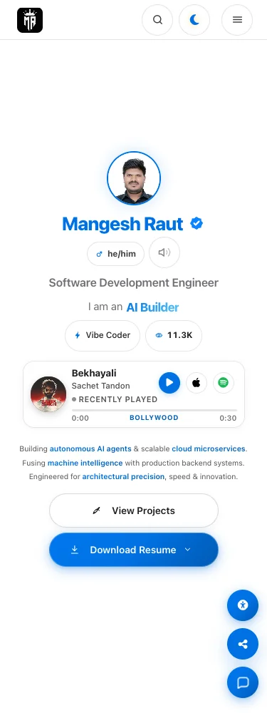
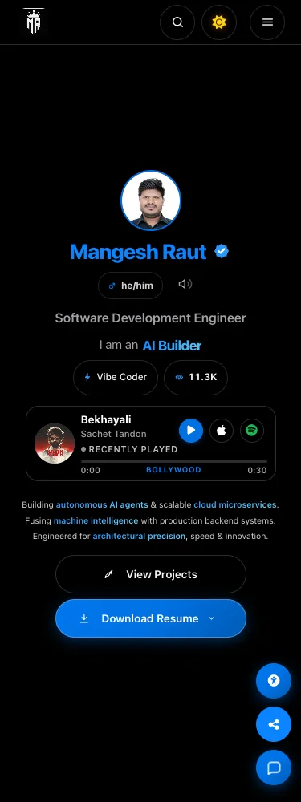

# Website screenshot gallery

Captured November 9, 2026 from the public GitHub Pages website using Chrome. These are real rendered pages with live data: no mocked APIs, generated mockups, or replacement text. The capture enables reduced motion and saves a 1000px-high viewport. Dynamic counters, music, and service status describe the capture time.

| Surface   | Desktop · 1440px                                                      | Tablet · 768px                                                      | Mobile · 375px                                                      |
| --------- | --------------------------------------------------------------------- | ------------------------------------------------------------------- | ------------------------------------------------------------------- |
| Home      | [Light](home-1440-light.webp) · [Dark](home-1440-dark.webp)           | [Light](home-768-light.webp) · [Dark](home-768-dark.webp)           | [Light](home-375-light.webp) · [Dark](home-375-dark.webp)           |
| Journal   | [Light](journal-1440-light.webp) · [Dark](journal-1440-dark.webp)     | [Light](journal-768-light.webp) · [Dark](journal-768-dark.webp)     | [Light](journal-375-light.webp) · [Dark](journal-375-dark.webp)     |
| Systems   | [Light](systems-1440-light.webp) · [Dark](systems-1440-dark.webp)     | [Light](systems-768-light.webp) · [Dark](systems-768-dark.webp)     | [Light](systems-375-light.webp) · [Dark](systems-375-dark.webp)     |
| Monitor   | [Light](monitor-1440-light.webp) · [Dark](monitor-1440-dark.webp)     | [Light](monitor-768-light.webp) · [Dark](monitor-768-dark.webp)     | [Light](monitor-375-light.webp) · [Dark](monitor-375-dark.webp)     |
| Travel    | [Light](travel-1440-light.webp) · [Dark](travel-1440-dark.webp)       | [Light](travel-768-light.webp) · [Dark](travel-768-dark.webp)       | [Light](travel-375-light.webp) · [Dark](travel-375-dark.webp)       |
| Uses      | [Light](uses-1440-light.webp) · [Dark](uses-1440-dark.webp)           | [Light](uses-768-light.webp) · [Dark](uses-768-dark.webp)           | [Light](uses-375-light.webp) · [Dark](uses-375-dark.webp)           |
| Changelog | [Light](changelog-1440-light.webp) · [Dark](changelog-1440-dark.webp) | [Light](changelog-768-light.webp) · [Dark](changelog-768-dark.webp) | [Light](changelog-375-light.webp) · [Dark](changelog-375-dark.webp) |




## Reproduce

From the repository root, with npm dependencies and Google Chrome installed:

```bash
node scripts/qa/capture-readme-screenshots.mjs
```

Use `SCREENSHOT_BASE_URL` for another serving root, including a local production build. The script closes its browser on success or failure and rejects page-level horizontal overflow. It does not click payment, booking, or message-submission controls. Images are WebP-compressed with their original dimensions; they live outside `src/` and do not ship to the website.

[manifest.json](manifest.json) records URLs, viewports, themes, source revision, browser version, and capture time. The source revision identifies the repository at capture time; verify deployed commit parity when capturing a remote host. This gallery covers resting page states, not every interaction or the full browser matrix.
